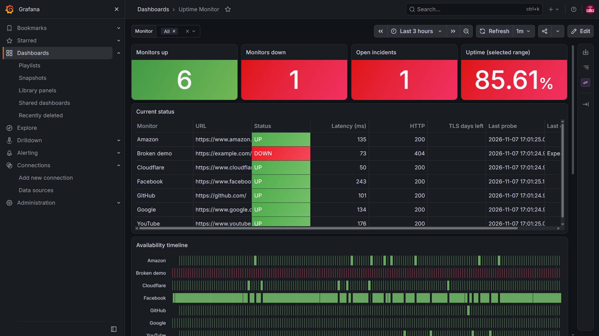
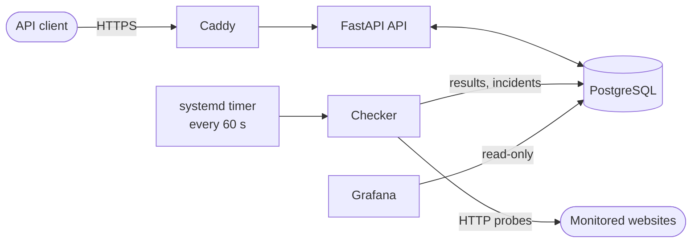

# Uptime Monitor

A small, self-hosted uptime monitor. It probes HTTP(S) endpoints every minute, records status, latency and TLS expiry, opens an incident when a site keeps failing, and shows everything in Grafana.



## Features

- Per-monitor interval, timeout and expected HTTP status
- Incidents that open after consecutive failures and resolve on recovery
- Response time and TLS certificate expiry tracking
- Grafana dashboard provisioned from the repo
- CI (tests, lint, container scan) and automated SSH deployment to an Azure VM

## Architecture



## Quick start

```bash
docker compose up --build
```

- API docs: http://localhost:8000/docs
- Grafana: http://localhost:3000

Create a monitor:

```bash
curl -X POST http://localhost:8000/api/monitors \
  -H "Content-Type: application/json" \
  -H "X-API-Key: $API_KEY" \
  -d '{"name":"Example","url":"https://example.com/","interval_seconds":60,"expected_status":200,"timeout_seconds":10}'
```

## Deployment

Runs on a single Azure VM without Docker: Python virtualenv, PostgreSQL, Grafana and Caddy, with the app managed by systemd. A manually triggered GitHub Actions workflow copies the code over SSH, applies migrations and restarts the services. Grafana is reached through an SSH tunnel.

## Tech stack

Python 3.11, FastAPI, SQLAlchemy, Alembic, PostgreSQL, Grafana, Caddy, systemd, GitHub Actions, Docker Compose
